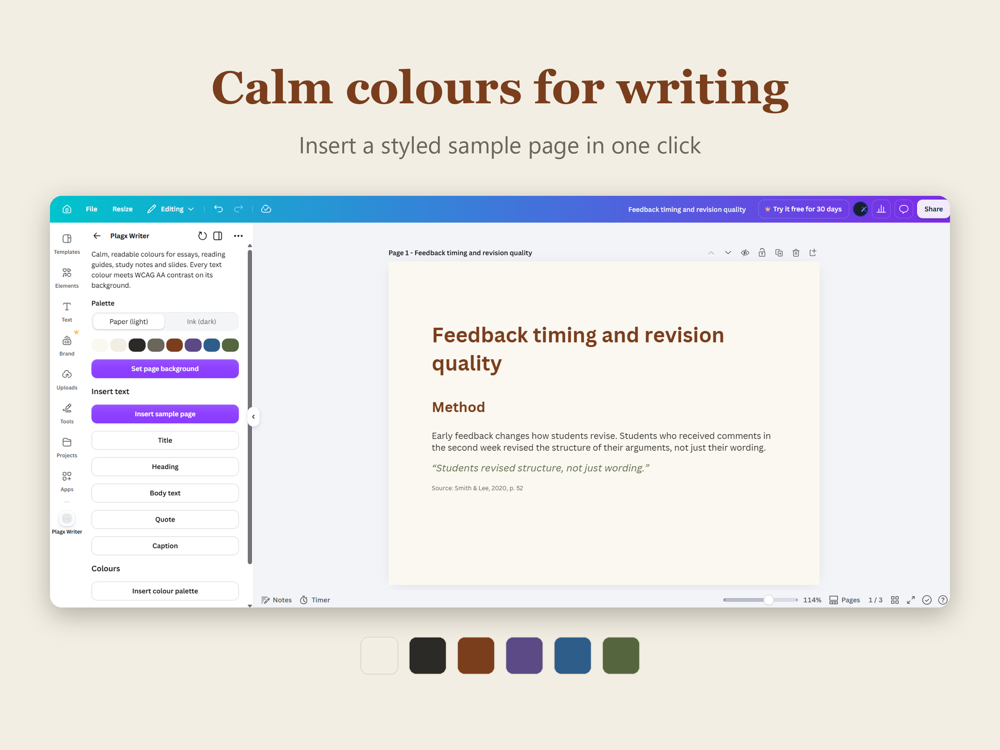

# Plagx Writer for Canva

Calm, readable colours and text styles for writing-focused designs: essays, reading guides, study notes and slides.

Plagx Writer is a Canva app with two palettes:

- **Paper (light)**: cream background, dark ink text, warm brown headings
- **Ink (dark)**: soft charcoal background, light text, amber headings

Every text colour meets WCAG AA contrast (4.5:1) on its background.



## Features

- Switch between Paper (light) and Ink (dark)
- Set the page background in one click, or click any colour to use it as the background
- **Insert sample page**: a laid-out title, heading, body, quote and caption in the palette's colours
- Insert single text styles: Title, Heading, Body text, Quote, Caption (sized to the page)
- Insert the colour palette, so the colours show up in Canva's "Document colours"

The app has no backend, no login and no AI, and it stores no data. It only uses the `canva:design:content` permission.

## Colours

| Role | Paper | Ink |
| --- | --- | --- |
| Background | `#FBF8F1` | `#1C1F24` |
| Surface | `#F3EEE3` | `#22262C` |
| Text | `#2B2A27` | `#DAD5C8` |
| Muted | `#6B665C` | `#9A9588` |
| Heading | `#7A3E1D` | `#E3AA70` |
| Emphasis | `#5B4A86` | `#BBA6E6` |
| Link | `#2F5D8A` | `#7FB0DC` |
| Quote | `#55663F` | `#AABA8F` |

The palette lives in [`src/intents/design_editor/palettes.ts`](src/intents/design_editor/palettes.ts) and the panel in [`app.tsx`](src/intents/design_editor/app.tsx).

## Run it locally

Requires Node 22 or 24 and a Canva developer account.

```bash
npm install
cp .env.template .env   # set CANVA_APP_ID to your app's ID
npm start               # serves the app on http://localhost:8080
```

In the [Canva Developer Portal](https://www.canva.com/developers/apps), set the app's Development URL to `http://localhost:8080` and click **Preview**.

Build for submission:

```bash
npm run build           # outputs dist/app.js and dist/messages_en.json
```

Listing images are generated by `python listing/build.py` from the screenshots in `listing/`.

## Also available

The same palettes for other tools: [VS Code](https://marketplace.visualstudio.com/items?itemName=plagiarismcheckerx.plagx-writer-theme) and [Obsidian](https://community.obsidian.md/themes/plagx-writer).

## Licence

Built on the [Canva Apps SDK starter kit](https://github.com/canva-sdks/canva-apps-sdk-starter-kit); see [LICENSE.md](LICENSE.md).

---

Made by [Plagiarism Checker X](https://plagiarismcheckerx.com/?utm_source=plagx-writer-canva-github). For checking text overlap between your own documents, see the [Text Similarity Detector](https://plagiarismcheckerx.com/?utm_source=plagx-writer-canva-github-readme).
